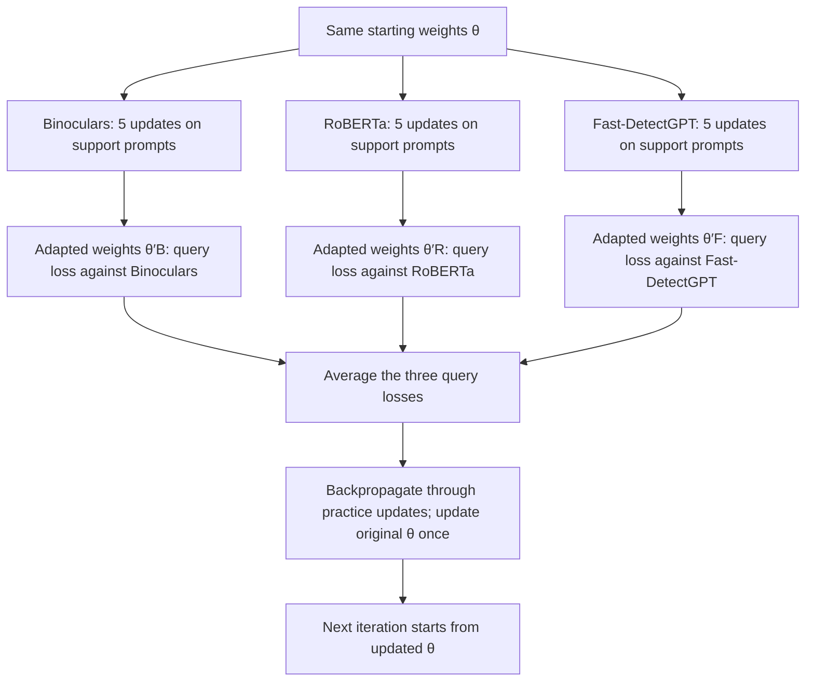

# AI Content Detection and Evasion Research

This subproject is a research workbench for three related questions:

1. Can a model distinguish AI-generated content from human-created content?
2. Can a generator learn to evade that detector while preserving the requested
   meaning or image prompt?
3. What happens when the detector is retrained on the attacker's new outputs?

It supports text and image detectors, detector ensembles, text and image evasion
methods, repeated attacker and defender updates, leakage-aware benchmarks, and a
Streamlit scoring application.

AI-content detection is statistical evidence, not proof of authorship. A score
can change with language, topic, generator, decoding settings, image processing,
and adversarial rewriting. Use this project to run controlled experiments or to
assist review, not as the sole basis for a consequential decision.

The bibliography is in [`references.bib`](ai_content_detector/references.bib). This README explains
the experimental workflow; the [detector catalogue](DETECTORS.md) explains
individual detection methods without requiring the reader to first read those
papers.

## The problem in plain language

AI generators leave patterns, but no single pattern is universal. A text model
might produce unusually predictable token sequences. An image generator might
leave frequency artifacts or react differently to denoising. A supervised
classifier can learn such patterns from examples, while a zero-shot detector can
derive a statistic from a pretrained model without training a new classifier.

An adaptive attacker makes the problem harder. It observes a detector score and
changes the generator to lower that score. A defender can then retrain on these
new evasive samples. This repository represents that loop as:

```text
prompt -> generator -> candidate content -> detector -> AI score
             ^                              |
             |________ evasion reward ______|

fixed evaluation set -> measure attacker -> retrain defender -> measure again
```

The key experimental question is therefore not only "does the detector work on
today's samples?" It is also "does it continue to work on samples optimized
against it, including samples from prompts and detectors that training never
saw?"

## Essential vocabulary

| Term | Meaning in this project |
|---|---|
| **Detector** | A component that maps text or an image to an AI-oriented score and a label. |
| **Supervised detector** | A classifier trained on labeled human and AI examples. It needs a fitted checkpoint. |
| **Zero-shot detector** | A method that computes a statistic using pretrained models without fitting a task-specific detector classifier. It can still require large model weights and a threshold. |
| **Raw statistic** | The detector's native measurement, such as a likelihood ratio, curvature, cosine similarity, or anomaly score. |
| **Calibration** | Learning a mapping from scores to probabilities on a separate representative validation set. |
| **Evasion attack** | A rewrite or generator update intended to reduce detection while retaining useful content. |
| **Attacker** | The generator or transformation being optimized. |
| **Defender** | The detector being evaluated or retrained. |
| **Held-out** | Data or a detector excluded from training and used only to test generalization. |
| **Checkpoint** | Saved trained weights or a fitted classical model. Large project checkpoints are not stored in git. |

## Quickstart

Run every command from the repository root. The project uses the root `uv`
environment and expects `PYTHONPATH=.` for module imports.

### 1. Create the environment

```bash
uv venv
source .venv/bin/activate
uv pip install -r requirements.txt
uv run python -m spacy download en_core_web_sm
```

On the CUDA 12.4 research VM, install the GPU environment instead:

```bash
uv pip install -r requirements_gpu.in
```

The standard installation is enough for the CPU and mock-based test suite. Most
large detectors and all meaningful training runs need downloaded Hugging Face
weights, project checkpoints, and usually a GPU. On macOS, XGBoost also requires
an OpenMP runtime such as `libomp`.

### 2. Check imports and wiring

```bash
PYTHONPATH=. uv run python -m ai_content_detector.rl_evasion.run_experiments \
  --experiment smoke_test
```

This is deliberately lightweight. It checks imports, configuration objects,
reward plumbing, and trainer construction. It does not download or run every
large model.

### 3. Run the focused test suite

```bash
PYTHONPATH=. uv run python -m pytest ai_content_detector/tests -q
```

These tests validate formulas, tensor shapes, label conventions, split
contracts, failure behavior, seeding, and leakage controls using CPU-scale
fixtures and mocks.

### 4. Launch the scoring app

```bash
PYTHONPATH=. uv run streamlit run ai_content_detector/app.py
```

Open the URL printed by Streamlit, select the text or image tab, choose the
available detectors, provide content, and run the analysis. The app reports why
a detector is unavailable. It does not replace a missing checkpoint with a
heuristic result. At least one usable detector is required.

The app treats text shorter than 50 characters as too short for reliable use.
Some individual methods impose stronger requirements. For example,
Disrupt-and-Recover defaults to at least 35 words.

### 5. Run a small benchmark

Once Hugging Face downloads are available, the following command downloads 20
HC3 examples and runs CPU-compatible attack baselines against a RoBERTa
detector. It is a practical pipeline check, not a publishable benchmark:

```bash
PYTHONPATH=. uv run python \
  -m ai_content_detector.rl_evasion.benchmarking.benchmark \
  --dataset hc3 \
  --max-samples 20 \
  --lightweight \
  --detectors roberta_classifier \
  --output-dir results/benchmark_quickstart
```

`--lightweight` changes the attack methods, not the scoring stack. This command
still downloads the RoBERTa detector, the E5 semantic encoder, HC3, and NLTK
resources. Use the smoke test and unit tests for an offline CPU check.

HC3 contains aligned prompts, human answers, and ChatGPT answers. The
CNN/DailyMail option contains prompts and human continuations but no stored AI
continuations, so it can evaluate generation methods but skips rewrite-only
methods that require an existing AI text.

## Repository map

```text
ai_content_detector/
├── app.py                              # Streamlit text and image UI
├── detectors/
│   ├── ensemble.py                    # Detector interface and aggregation
│   ├── text_detectors.py              # Text detectors
│   ├── image_detectors.py             # Image detectors
│   └── style_detector.py              # LUAR few-shot style detector
├── rl_evasion/
│   ├── config.py                      # Reproducible experiment configs
│   ├── run_experiments.py             # Unified experiment CLI
│   ├── text_evasion/                  # GRPO, SPIN, rewards, features
│   ├── image_evasion/                 # DDPO training and evaluation
│   ├── arms_race/                     # Repeated adaptation and MAML
│   └── benchmarking/                  # Datasets, baselines, runner
├── references.bib
└── tests/
```

Internal supervised detectors reuse checkpoint loading and model wrappers from
`ml_pipeline/`. Shared checkpoint behavior should remain there rather than being
duplicated in this subproject.

## Detector interface and score semantics

Every detector implements `BaseDetector`:

```python
result = detector.detect(content)

result.score          # float in [0, 1], oriented so larger means more AI-like
result.label          # "human", "ai", "uncertain", or "error" in an ensemble
result.detector_name  # runtime detector name
result.details        # raw statistic, thresholds, semantics, or failure context
```

`is_available()` checks dependencies, model configuration, support data, and
checkpoints. `unload()` releases known model references and clears CUDA cache
when possible. Heavy models are loaded lazily.

### A score is not automatically a probability

All public scores use the same direction, with `0` more human-like and `1` more
AI-like. That common range makes display and aggregation convenient, but it does
not give every number the same interpretation.

- `classifier_probability` comes from a fitted classifier's softmax or
  `predict_proba`. It is still only as reliable as that classifier's data.
- `calibrated_probability` means a separate calibrator was fitted on labeled
  validation examples.
- `uncalibrated_*` means the value is a normalized or monotonic display score.
  It preserves ordering but must not be read as confidence.
- A raw statistic and its decision threshold are retained in `details` when a
  paper method makes its decision in the raw space.

For illustration, suppose Binoculars computes a raw ratio of `0.77`. Its
display transform is `sigmoid((0.9015 - raw) / 0.05)`, which maps `0.77` to
`0.93` and the paper threshold itself to exactly `0.5`, and
`details["score_semantics"]` is `uncalibrated_monotonic_transform`. Nothing was
fitted; the map was chosen to put `0.5` at the threshold so the display score
stays readable around the decision point. Read `0.93` as "further below the
threshold than `0.60` would be", not as "93 percent probability".

Inspect `result.details["score_semantics"]` whenever it is present.

The generic three-way helper labels scores at least `0.65` as `ai`, at most
`0.35` as `human`, and the interval between them as `uncertain`. Methods with a
native paper threshold make their label from the raw paper statistic instead,
which is why Binoculars and Fast-DetectGPT never return `uncertain`.

### Ensemble behavior

`EnsembleAggregator` runs all selected detectors independently. Its default
weighted average is

$$
S_{\mathrm{ensemble}} = \sum_{j=1}^{m} \tilde{w}_j S_j,
\qquad
\tilde{w}_j = \frac{w_j}{\sum_k w_k}.
$$

For illustration, suppose three equally weighted detectors return the following
outputs. These are hypothetical scores, not measured results:

| detector | score | label |
| --- | --- | --- |
| Binoculars | 0.067 | human |
| TF-IDF + logistic regression | 0.62 | uncertain |
| ModernBERT | 0.83 | ai |

The average is `(0.067 + 0.62 + 0.83) / 3 = 0.506`, but the aggregate **label**
comes from votes, not from that number: one `ai` vote and one `human` vote
cancel, so the label is `uncertain` even though the score sits above `0.5`. The
two rules answer different questions, which is why `aggregate_score` and
`aggregate_label` are reported separately.

Without a fitted logistic calibrator, this is an uncalibrated normalized score
and the label comes from detector votes. With a calibrator fitted on disjoint
labeled validation data, the aggregate is reported as a calibrated probability
and the label comes from a `0.5` cut. An empty ensemble, a calibration set with
one class, and a run in which every detector fails all raise clear errors. A
failure from one detector appears in the per-detector results with label `error`
and is excluded from the aggregate.

## Detector catalogue

See the [text and image detector catalogue](DETECTORS.md) for individual methods,
worked illustrations, formulas, and implementation requirements. The sections
below focus on evasion, adaptation, and evaluation.

## Evasion methods

### The reward design

Text and image attacks optimize more than detector evasion. If the only reward
were `1 - detector_score`, a generator could emit empty or irrelevant content.
The text configuration therefore combines detector evasion, semantic
similarity, and a length and quality term:

$$
R_{\mathrm{text}} = 0.6R_{\mathrm{evasion}}
                  + 0.3R_{\mathrm{semantic}}
                  + 0.1R_{\mathrm{quality}}.
$$

The image default combines detector evasion and CLIP prompt alignment with
weights `0.7` and `0.3`. Its aesthetic weight is zero because no trained
aesthetic model is bundled. Missing or invalid detector rewards fail clearly.

### One example used by the three text methods

The text methods below use the same illustrative item. Generated completions,
detector scores, similarities, and rewards are hypothetical examples, not
measured results. Dataset loading and prompt construction are described in the
implementation; this question-and-answer item is for explanation only:

- **Prompt:** `Explain why sourdough bread rises.`
- **Human reference** (illustrative): `Wild yeast and bacteria eat
  the sugars in the flour and give off carbon dioxide, and the gluten network
  traps that gas. In the oven the starch sets, so the loaf keeps the shape the
  gas gave it.`
- **Detector:** any detector that returns an AI-oriented score in $[0, 1]$, for
  example `BinocularsDetector`. Lower means less AI-like according to that detector.

### GRPO text evasion

The model learns from rewards on its own generated continuations. This
implementation still uses training prompts and human reference continuations
from a corpus: the references supply semantic-similarity and length rewards.
It does not require pre-labelled preference pairs.

`GRPOTextEvasionTrainer` samples `grpo_num_generations = 4` completions for the
prompt and scores each with the reward above (including the length term):

| completion | detector score | semantic | reward |
| --- | --- | --- | --- |
| "Sourdough rises because wild yeast ferments the sugars in flour and produces carbon dioxide gas, which expands inside the dough during baking." | 0.81 | 0.94 | 0.48 |
| "Bakers mix water and starter into the flour, and tiny organisms consume the sugars and exhale gas that inflates the dough." | 0.44 | 0.91 | 0.69 |
| "It rises." | not scored | not scored | 0.00 (too short) |
| "The leavening cultures feed on the flour, the dough traps the gas they emit, and heat fixes the risen structure." | 0.52 | 0.93 | 0.64 |

The reward is normalized **inside the group**, so each completion is compared
with the group mean: $A_i = (r_i - \bar{r}) / \sigma_r$. The best completion gets a
positive advantage and the worst a negative one, encouraging higher-reward
continuations. Outputs shorter than 20 whitespace-separated words receive zero
reward before detector or semantic scoring. Semantic and length rewards further
discourage irrelevant or degenerate outputs, without guaranteeing quality.

No critic and no value network: the group average replaces them. A KL penalty
(`grpo_kl_coeff = 0.05`) against the reference model keeps the policy from
drifting away from the starting weights. The generator is adapted with LoRA.
The method is called GRPO only when the TRL implementation is available; the
local fallback is explicitly named group-normalized REINFORCE and is disabled
by default.

### SPIN with feature monitoring

No reward and no detector: the model learns from its own samples plus the human
continuation.

`SPINTrainerWithFeatureMonitoring` alternates two steps on the same item.

1. **Generate.** The current model writes its own continuation, typically with a
   high temperature so it drifts: `Sourdough rises due to the activity of yeast
   and bacteria present in the starter, which metabolize sugars into gas during
   fermentation, causing the dough to expand as it bakes.`
2. **Prefer.** The human continuation is `chosen`, the generated one is
   `rejected`, and the loss raises the human continuation's relative
   log-probability:

$$
\mathcal{L}_{\mathrm{SPIN}} = -\mathbb{E}\left[\log \sigma\left(\beta\left(
  \left[\log \pi_\theta(y_h) - \log \pi_{\mathrm{ref}}(y_h)\right]
- \left[\log \pi_\theta(y_g) - \log \pi_{\mathrm{ref}}(y_g)\right]\right)\right)\right].
$$

With $\beta = 0.1$ (`beta_spin`), the update simply moves probability mass
toward "wild yeast and bacteria" phrasing and away from the flat textbook
sentence, without any detector ever being called during training. The frozen
reference snapshot advances after each SPIN iteration. Log-probabilities are
conditional on the prompt and cover the continuation only, so prompt tokens do
not dominate the signal.

Stylometric statistics, E5 embeddings, LUAR style embeddings, and learned probe
features are monitoring outputs. They are not gradient losses because decoding
text breaks a differentiable path from those features back to model parameters.
`MultiSPINTrainer` remains as a compatibility alias.

### Adversarial paraphrasing

No training at all: the detector is called at every generated token.

`AdversarialParaphrasingBaseline` rewrites the example text token by token. At
each position it takes the candidates from top-p `0.99`, keeps at most top-k
`50`, decodes the partial paraphrase for each one, and asks the detector to
score it.

An illustrative candidate comparison (assuming the guidance detector can score
these short prefixes):

| candidate token | partial paraphrase | detector score |
| --- | --- | --- |
| "Wild" | `Wild` | 0.46 |
| "Naturally" | `Naturally` | 0.38 |
| "The" | `The` | 0.79 |
| "In" | `In` | 0.71 |

The lowest score wins, so the step commits to "Naturally", and the search
continues from that prefix. The detector is in the loop at every token, which is
why this is far more expensive than ordinary sampling and why it requires a real
guidance detector.

The benchmark also includes simpler controls: no transformation, neural
paraphrasing, WordNet synonym substitution, human-style prompt instructions,
high-temperature sampling, and optional OpenRouter generation.

GRPO queries detectors during training; SPIN trains on human/generated
continuation pairs without detector queries. Both generate normally afterwards. Adversarial paraphrasing pays at every token of every generation.

### DDPO image evasion

`DDPOImageEvasionTrainer` fine-tunes a diffusion image generator in three steps:

1. **Generate** images from prompts, storing each image's sequence of denoising
   decisions (50 steps by default).
2. **Score** the final images: 70% detector evasion reward (one minus the mean
   detector AI score) and 30% CLIP prompt alignment.
3. **Update** the generator's UNet LoRA weights to make decisions associated with
   above-baseline rewards more likely, and those with below-baseline rewards less
   likely. DDPO-IS uses a clipped policy-gradient objective to limit updates.

Repeat this loop to favor images that evade the detectors while matching the
prompt. "More human-like" means lower detector AI scores here; human-perceived
realism and image quality are not guaranteed.

### MAML fast adaptation

`MAMLAdaptation` learns text attacker LoRA starting weights that work well after
five updates against a detector. Each iteration samples up to three detectors.
Every detector branch starts from the **same weights θ**, practices on *support*
prompts, then computes a loss on different *query* prompts using that same
detector. For example:



**Support prompts determine the adaptation; query prompts determine how to
improve its starting point.** Query prompts contribute to training, not final
independent evaluation. The adapted branch weights are discarded; the shared
starting weights are retained and saved as `meta_init`.

The CLI evaluates adaptation to a held-out detector against the exact pre-meta
starting weights. By default, second-order MAML differentiates through the
practice gradients; `--first-order` uses FOMAML to reduce compute and memory.

### Repeated attacker and defender adaptation

Both sides move, so a single attacker or a single retrain is not the story.

`ArmsRaceExperiment` runs `num_rounds` rounds on a fixed evaluation prompt split
that neither side trains on. Before round 1, the initial generator produces
continuations on training prompts to warm up the defender against matched human
references. Warm-up uses the existing defender budget (up to 2,000 total examples,
3 epochs by default), with an internal 80/20 training/validation split and the
best validation-loss checkpoint retained. The attacker is not updated during
warm-up. The warmed-up defender enters the attacker reward ensemble before the
first attacker update. Warm-up checkpoints are saved under `defender/warmup/`
and its internal validation metrics in `defender_warmup.json`; race rounds keep
their numbering starting at 1. The race reuses the attacker's held-out prompt
split (`TextEvasionConfig.evaluation_fraction`, default 0.2).

Warm-up protocol and configuration checks were validated with
`PYTHONPATH=. uv run --with pytest python -m pytest ai_content_detector/tests/test_equilibrium_math.py ai_content_detector/tests/test_config.py -q`.
Full GPU training was not validated locally. GRPO contract test collection was
blocked locally by PyArrow requiring NumPy 2.0 or newer while NumPy 1.26.3 was
installed.

Within each round it takes three paired
measurements on the *same* prompts with the *same* sampling seed:

| measurement point | what it means |
| --- | --- |
| before attacker update | the attacker's current evasion against the current defender |
| after attacker update | how much the attacker gained |
| after defender update | how much of that gain the defender recovered |

The attacker step budget is enforced. `AdaptiveClassifierDefender` then
retrains a RoBERTa classifier on fresh attacker outputs paired with matched
human references, and the retrained detector is pushed back into the attacker's
detector ensemble, which closes the loop. The following numbers are illustrative,
not verified results from a recorded run. Each value is `attack_success_rate`:
the fraction of generated evaluation texts with defender AI probability below
0.5. Higher values mean more successful evasion.

| round | before attacker | after attacker | after defender |
| --- | --- | --- | --- |
| 1 | 0.18 | 0.71 | 0.49 |
| 2 | 0.31 | 0.83 | 0.62 |
| 3 | 0.44 | 0.88 | 0.71 |

In this example, attacker updates increase evasion, while defender updates reduce
it by 22, 21, and 17 percentage points. These numbers do not establish convergence
or non-convergence.

The experiment records paired repeated-update measurements, not a Nash equilibrium
or a Nash gap. `RADARDefender` is only a compatibility alias; this is not the
RADAR alternating paraphraser and detector algorithm. Image arms-race mode is
intentionally rejected because an adaptive image defender is not implemented.

## Evaluation and leakage controls

### Data flow

Text and image prompt sets are split deterministically before training. The
evaluation portion is immutable. MAML additionally separates support prompts,
used for inner adaptation, from query prompts, used for its meta-objective.

Benchmark datasets validate one-to-one alignment between prompts, AI texts,
human references, and sample identifiers. They record a source revision when
the dataset exposes one. Trained GRPO and SPIN checkpoints record method,
optimized detector names, and seed metadata. The benchmark rejects an attack
checkpoint whose optimized detector names overlap declared held-out detectors.
Training sample IDs are not yet stored in attack checkpoints, so sample-level
overlap cannot yet be rejected automatically.

Methods declare whether they rewrite an existing text, generate a new text from
a prompt, or support both. Incompatible dataset and method pairs are reported as
skipped. Failed transformations are counted and excluded; the original text is
never substituted as a successful evasion output.

### Metrics

- **AUROC** measures how often a random AI example receives a higher score than
  a random human example across all thresholds. It requires both classes.
- **False-positive rate (FPR)** is the fraction of human examples incorrectly
  labeled AI at a threshold.
- **True-positive rate (TPR)** is the fraction of AI examples correctly labeled
  AI at that threshold.
- **TPR at a target FPR** uses the best empirically achievable threshold at or
  below the requested FPR. It does not interpolate an unattainable operating
  point.
- **Attack success rate** is the fraction of generated examples whose mean
  evasion reward exceeds `0.5`, equivalently whose mean detector AI score is
  below `0.5`. It does not require that the original example was first detected.
- **Semantic similarity** or **CLIP alignment** checks that successful evasion
  did not simply discard the requested content.

Empty, misaligned, non-finite, and invalid single-class metric inputs are
rejected rather than turned into plausible-looking results.

### Feature and notebook leakage controls

`FeatureBank` selects probes on a group-disjoint validation partition and fits
its scaler on training data only. The explainability notebook assigns stable
document identifiers before paragraph expansion, uses document-disjoint train,
validation, and test sets, restores sentence segmentation, labels SHAP direction
for the actual class, and reserves test data for final evaluation.

## Running experiments

The unified entry point is:

```bash
PYTHONPATH=. uv run python -m ai_content_detector.rl_evasion.run_experiments \
  --experiment <name>
```

| Experiment | Example | Main requirement and output |
|---|---|---|
| Smoke test | `--experiment smoke_test` | CPU wiring check; no training |
| GRPO text | `--experiment grpo_text --model Qwen/Qwen3.5-9B-Base --epochs 3` | Local causal LM, TRL, detectors, GPU; saves a final adapter and metadata |
| SPIN | `--experiment multispin --epochs 5` | Local causal LM, CNN/DailyMail, GPU; saves one checkpoint per iteration |
| DDPO image | `--experiment ddpo_image --epochs 50` | Stable Diffusion, image detectors, GPU; saves diffusion LoRA checkpoints |
| Arms race | `--experiment arms_race --modality text --rounds 10` | Working text attacker and adaptive defender; saves round history |
| Meta-adaptation | `--experiment meta_adapt --epochs 100` | At least two functioning detectors, LoRA model, GPU; saves `meta_init` |
| Benchmark | `--experiment benchmark --dataset hc3 --epochs 200` | Here `--epochs` is used as the maximum sample count; saves benchmark JSON |

Shared options are `--model`, `--epochs`, `--rounds`, `--modality`,
`--first-order`, `--dataset`, and `--output-dir`. Configuration dataclasses in
`rl_evasion/config.py` expose the remaining learning rates, batch sizes, reward
weights, prompt splits, seeds, and checkpoint intervals.

For finer benchmark control, including explicit held-out detectors and
checkpoints, call the benchmark module directly:

```bash
PYTHONPATH=. uv run python \
  -m ai_content_detector.rl_evasion.benchmarking.benchmark \
  --dataset hc3 \
  --max-samples 200 \
  --detectors binoculars fast_detect_gpt \
  --heldout-detectors diveye \
  --grpo-checkpoint results/text_evasion/grpo/final \
  --output-dir results/benchmark
```

OpenRouter baselines are added only when `OPENROUTER_API_KEY` is present. API
failures are counted as failures and never fall back to returning the prompt.

## Required models and external resources

| Component | What must be supplied |
|---|---|
| ModernBERT and TF-IDF | Artifacts under the existing `ml_pipeline` `bench_aitextdetect` checkpoint registry |
| EfficientNet, CLIP, and DINOv2 classifiers | Artifacts under `bench_imai_artifact` |
| Binoculars and Fast-DetectGPT | Their Hugging Face causal language models; CUDA is required by availability checks |
| DivEye | Scoring LM plus fitted XGBoost classifier with the nine-feature schema |
| Disrupt-and-Recover | Recovery callable or OpenAI-compatible API, plus a BERTScore transformer checkpoint |
| IPAD | Phi-3 base model, three released adapters, and a large GPU |
| LUAR style detector | LUAR weights plus task-specific human and AI support sets |
| MLEP | Trained ResNet-50 classifier checkpoint |
| WaRPAD | DINOv2 ViT-L/14 weights, plus a validation threshold or calibrator for classification |
| Denoising trajectory | Stable Diffusion and CLIP ViT-L/14 weights |
| GRPO, SPIN, MAML, and DDPO | Local trainable base models, datasets, functioning reward detectors, and GPU memory |

Useful optional environment variables are:

```bash
export OPENROUTER_API_KEY=...   # OpenRouter benchmark or D&R recovery
export OPENAI_API_KEY=...       # OpenAI-compatible D&R recovery
export OPENAI_BASE_URL=...      # Alternate OpenAI-compatible endpoint
export DR_RECOVERY_MODEL=...    # Recovery model ID for D&R
```

Do not commit keys. Model and dataset downloads also require network access and,
for gated models, the provider's authentication and license acceptance.

## Extending the project

### Add a detector

1. Subclass `BaseDetector` in the appropriate detector module.
2. Set `name` and `modality`.
3. Implement `detect()` and return a `DetectionResult` with an AI-oriented score.
4. Put the native statistic, threshold, class order, and `score_semantics` in
   `details`.
5. Implement a truthful `is_available()` and rely on `unload()` or extend its
   resource list for heavy state.
6. Add focused tests for boundary decisions, batches, missing resources, label
   ordering, and score direction.
7. Register it in the app or experiment detector zoo only after its dependencies
   and failure behavior are explicit.

### Add an evasion method

Declare whether it rewrites existing content or generates from prompts. Preserve
sample identifiers in training metadata, record every detector optimized by the
method, and separate training data from final evaluation. A failed example must
remain a failed example rather than being replaced by the unmodified input.

## Validation status

The current checkout's local validation pass completed the full CPU and
mock-based suite:

```text
179 passed in 5.83s
```

Focused WaRPAD, MAML, and benchmark-contract tests passed `15` tests. Focused
Disrupt-and-Recover tests passed `5` tests after installing the declared
`bert-score==0.3.13` dependency. The following checks also passed:

```bash
PYTHONPATH=. UV_CACHE_DIR=/tmp/uv-cache uv run python \
  -m ai_content_detector.rl_evasion.run_experiments --experiment smoke_test

PYTHONPATH=. UV_CACHE_DIR=/tmp/uv-cache uv run python \
  -c 'import ai_content_detector.app'

PYTHONPATH=. UV_CACHE_DIR=/tmp/uv-cache uv run python -m compileall -q \
  ai_content_detector

git diff --check
```

These results establish formula, interface, boundary, and leakage behavior for
the tested paths. They do not establish parity with published metrics.

Local end-to-end validation was limited by unavailable Hugging Face access,
absent internal checkpoints, and a macOS XGBoost load failure caused by missing
`libomp`. The Streamlit module imported successfully and reported those missing
resources, but a real browser session with loaded checkpoints was not run. The
explainability notebook is valid JSON and was inspected, but its dataset loading,
XGBoost training, SHAP plots, and metrics were not executed in this checkout.

## Next steps before relying on research results

The following work is intentionally still open. It replaces the former separate
limitations document and is ordered from validation fundamentals to new
capabilities.

1. **Run real-model validation on the research VM.** Exercise Binoculars,
   Fast-DetectGPT, DivEye, IPAD, LUAR, WaRPAD, and denoising-trajectory inference
   end to end. Run GRPO, SPIN, MAML, DDPO, and repeated adaptation on a GPU. Run
   the Streamlit app in a browser with real checkpoints.

2. **Build immutable benchmark manifests and reproduce paper protocols.** Pin
   dataset revisions, model revisions, preprocessing, prompts, seeds, and
   calibration artifacts. Then reproduce AUROC, TPR, FPR, attack-success, and
   convergence measurements. No published metric has yet been reproduced in
   this checkout.

3. **Train and version the missing artifacts.** Produce the DivEye XGBoost
   classifier, MLEP ResNet-50, internal text and image checkpoints, LUAR support
   sets, and per-detector and ensemble calibrators. Store their schemas, class
   order, training sample identifiers, and provenance beside each artifact.
   Extend attack checkpoint metadata and benchmark checks so held-out sample IDs
   are rejected automatically, just as held-out detector overlap is today.

4. **Calibrate for each deployment domain.** Fit thresholds and calibrators on
   representative validation data disjoint from training and final testing.
   Recheck them across language, topic, generator family, decoding strategy,
   image post-processing, and attack type. A universal calibration artifact
   would be misleading.

5. **Validate external-resource methods.** Run real BERTScore plus network
   recovery for Disrupt-and-Recover. Establish DTAD parity against a complete
   runnable primary reference if one becomes available. Until then, retain its
   raw similarity semantics and avoid paper-parity claims.

6. **Execute the explainability notebook on the VM.** Materialize the
   document-disjoint splits, train XGBoost, generate SHAP analyses, and save the
   exact dataset and model provenance before relying on any plots or metrics.

7. **Complete deliberately out-of-scope method pieces if needed.** Add a validated
   aesthetic reward before assigning it nonzero weight, and implement an adaptive
   image defender before enabling image arms-race experiments.

8. **Keep practical variants named honestly.** Window smoothing is not a
   token-level MRF, adaptive RoBERTa retraining is not RADAR, SPIN feature signals
   are monitoring-only, and paraphrase round-trip and wavelet energy are
   heuristic baselines. Compatibility aliases may remain for callers, but new
   results should use the precise runtime names.

9. **Test reproducibility across the production stack.** The audited paths seed
   Python, NumPy, Torch, and explicit sampling generators, but bitwise equality
   is not guaranteed across CUDA devices, drivers, mixed-precision kernels,
   distributed training, or third-party model releases. Treat saved provenance
   and statistically consistent reruns as the reproducibility contract.

Until those steps are complete, interpret uncalibrated scores as comparative
signals and the current tests as correctness checks, not proof of real-world or
paper-level performance.
