# Retained attacker results and defender updates

The generator is `Qwen/Qwen3.5-9B-Base`. Three retained long-run attackers were trained against Gemma, ModernBERT-large and the seven-detector ensemble. Their step-500 checkpoints and final saved checkpoints are retained. A separate RoBERTa step-500 checkpoint is retained to document its fluctuating trajectory.

## Completed defender updates

| defender | evasion_before | evasion_after | AI_detection_after | human_FPR_after | allocation_time |
| --- | --- | --- | --- | --- | --- |
| gemma | 0.7720 | 0.0020 | 0.9980 | 0.0020 | 00:47:35 |
| modernbert | 0.9680 | 0.0100 | 0.9900 | 0.0040 | 00:41:45 |
| ensemble | 0.9480 | 0.0040 | 0.9960 | 0.0000 | 01:31:13 |

Each comparison scores the same 500 saved attack texts and 500 human passages before and after one defender update, at threshold 0.5. The attackers remain unchanged. Detection largely recovers against these fixed attackers. Resistance to another round of adaptive RL has not been tested. The per-member ensemble tables below retain differences hidden by the aggregate score.

## Retained detection results

Evasion means the fraction of generated outputs with AI score below 0.5. The ensemble uses the arithmetic mean of its seven AI scores. The full evaluations use 500 generated texts and 500 human passages. RoBERTa's update-500 result uses a 100-prompt diagnostic subset, as labelled.

| target | updates | generated_texts | evasion | human_FPR | semantic_similarity |
| --- | --- | --- | --- | --- | --- |
| Gemma | 1213 | 500 | 0.7720 | 0.0000 | 0.8867 |
| ModernBERT-large | 1487 | 500 | 0.9680 | 0.0160 | 0.8821 |
| Seven-detector ensemble | 502 | 500 | 0.9480 | 0.0020 | 0.8701 |
| RoBERTa (diagnostic) | 500 | 100 | 0.9800 | 0.0700 | 0.8739 |

All three long runs used eight total completions per update and no TRL KL penalty. Their original learning rate started at `5e-5` and decayed over an 11,988-update horizon. Their step-500 adapters remain available, but no separate full detection evaluation was recorded exactly at 500. The ensemble's full result was measured at 502, not 500.

Semantic similarity is E5 cosine similarity to the human reference. It does not establish factual accuracy or absence of policy drift. The ensemble text inspection found repeated attribution and some changed facts despite readable continuations.

## Gemma: retained checkpoints

Step 500: `/lustre/fswork/projects/rech/mbm/ual37ci/bench_research_ml_project/split-repos/ai-content-robustness/results/research_workflow/defender_comparison/rl/decoder/milestones/step_500`.

Final saved attacker: `/lustre/fswork/projects/rech/mbm/ual37ci/bench_research_ml_project/split-repos/ai-content-robustness/results/research_workflow/defender_comparison/rl/decoder/checkpoint-1213` at 1213 updates.

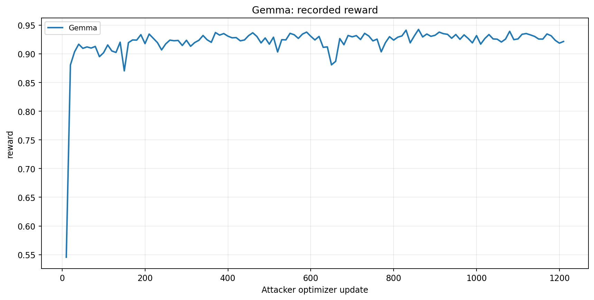

[Source CSV](figures/research/retained-gemma-reward.csv) · [Vector SVG](figures/research/retained-gemma-reward.svg).

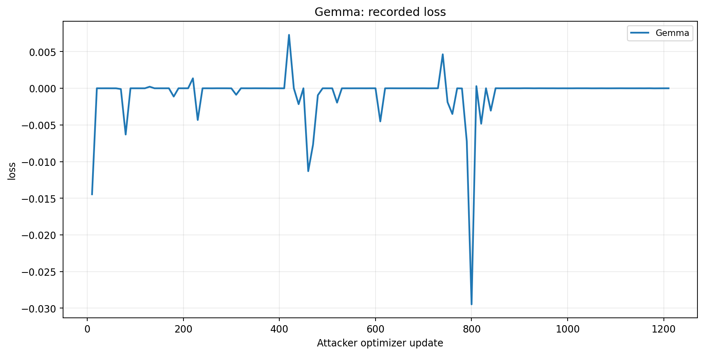

[Source CSV](figures/research/retained-gemma-loss.csv) · [Vector SVG](figures/research/retained-gemma-loss.svg).

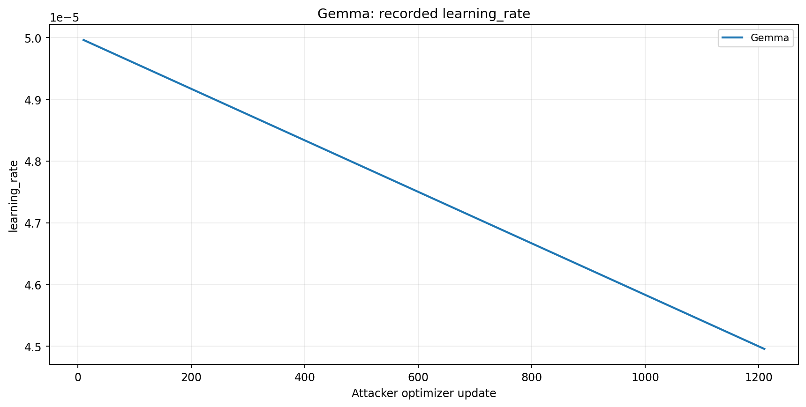

[Source CSV](figures/research/retained-gemma-learning_rate.csv) · [Vector SVG](figures/research/retained-gemma-learning_rate.svg).

## ModernBERT-large: retained checkpoints

Step 500: `/lustre/fswork/projects/rech/mbm/ual37ci/bench_research_ml_project/split-repos/ai-content-robustness/results/research_workflow/defender_comparison/rl/encoder/milestones/step_500`.

Final saved attacker: `/lustre/fswork/projects/rech/mbm/ual37ci/bench_research_ml_project/split-repos/ai-content-robustness/results/research_workflow/defender_comparison/rl/encoder/checkpoint-1487` at 1487 updates.

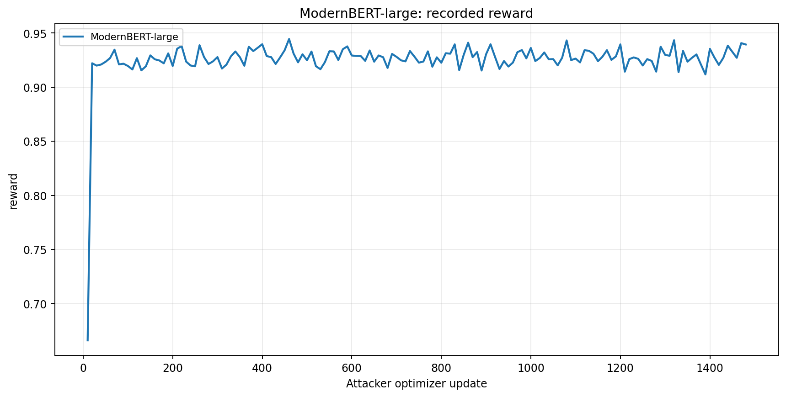

[Source CSV](figures/research/retained-modernbert-reward.csv) · [Vector SVG](figures/research/retained-modernbert-reward.svg).

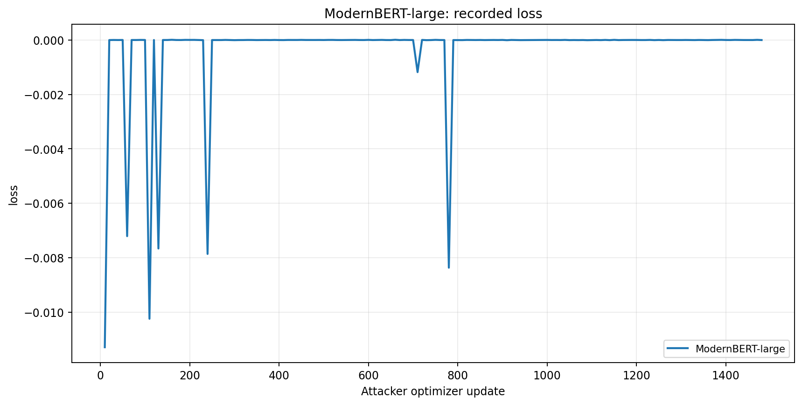

[Source CSV](figures/research/retained-modernbert-loss.csv) · [Vector SVG](figures/research/retained-modernbert-loss.svg).

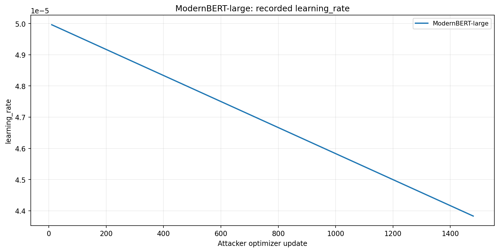

[Source CSV](figures/research/retained-modernbert-learning_rate.csv) · [Vector SVG](figures/research/retained-modernbert-learning_rate.svg).

## Seven-detector ensemble: retained checkpoints

Step 500: `/lustre/fswork/projects/rech/mbm/ual37ci/bench_research_ml_project/split-repos/ai-content-robustness/results/research_workflow/defender_comparison/rl/ensemble/checkpoint-500`.

Final saved attacker: `/lustre/fswork/projects/rech/mbm/ual37ci/bench_research_ml_project/split-repos/ai-content-robustness/results/research_workflow/defender_comparison/rl/ensemble/checkpoint-502` at 502 updates.

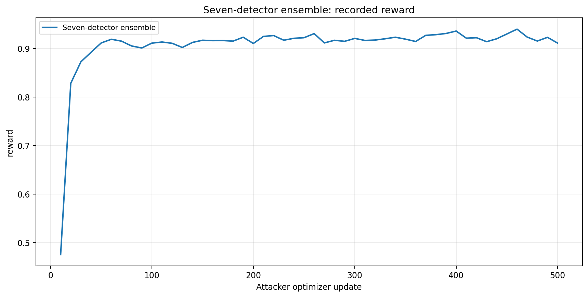

[Source CSV](figures/research/retained-ensemble-reward.csv) · [Vector SVG](figures/research/retained-ensemble-reward.svg).

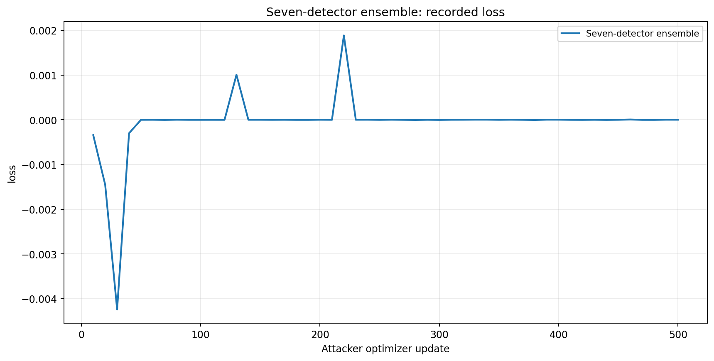

[Source CSV](figures/research/retained-ensemble-loss.csv) · [Vector SVG](figures/research/retained-ensemble-loss.svg).

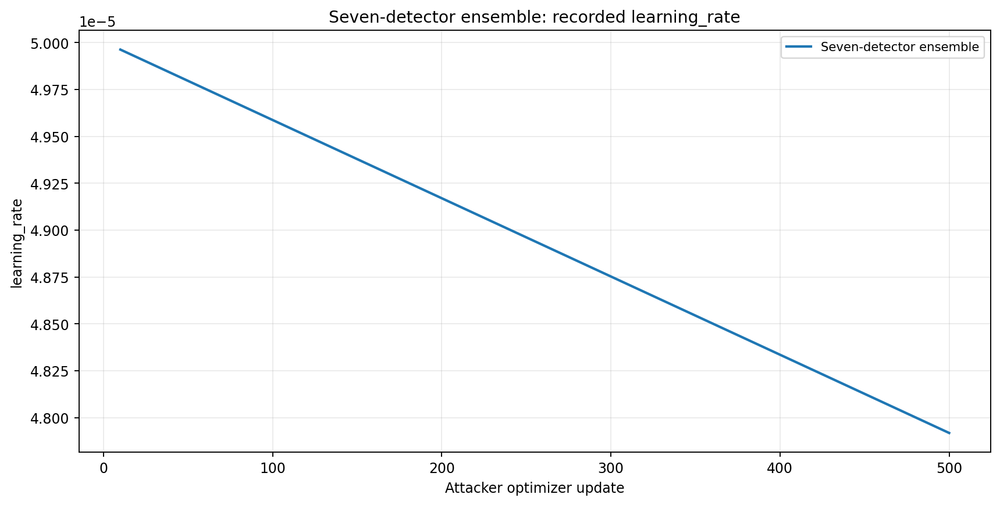

[Source CSV](figures/research/retained-ensemble-learning_rate.csv) · [Vector SVG](figures/research/retained-ensemble-learning_rate.svg).

## RoBERTa: retained checkpoints

Step 500: `/lustre/fswork/projects/rech/mbm/ual37ci/bench_research_ml_project/split-repos/ai-content-robustness/results/research_workflow/defender_comparison/retained_attackers/roberta/checkpoint-500`.

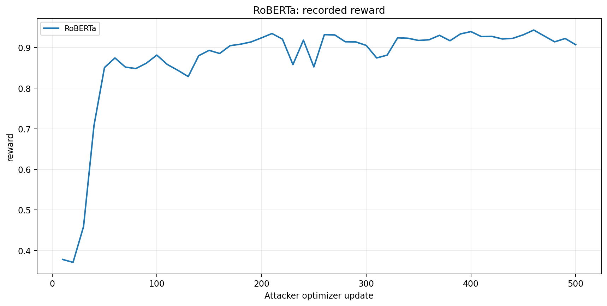

[Source CSV](figures/research/retained-roberta-reward.csv) · [Vector SVG](figures/research/retained-roberta-reward.svg).

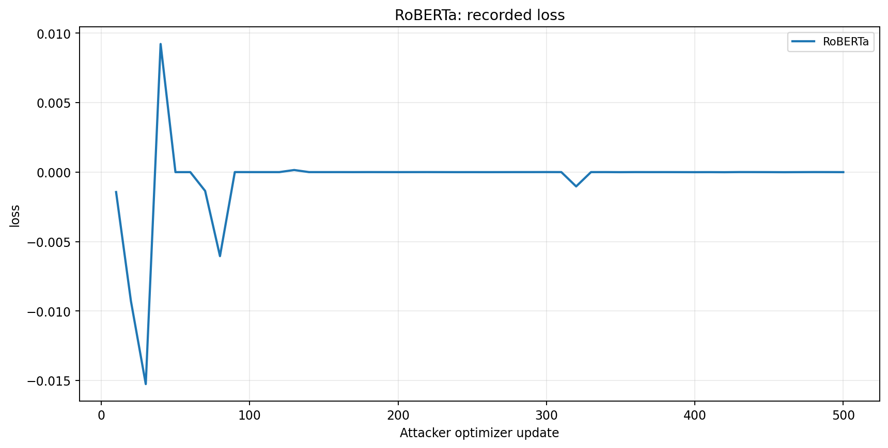

[Source CSV](figures/research/retained-roberta-loss.csv) · [Vector SVG](figures/research/retained-roberta-loss.svg).

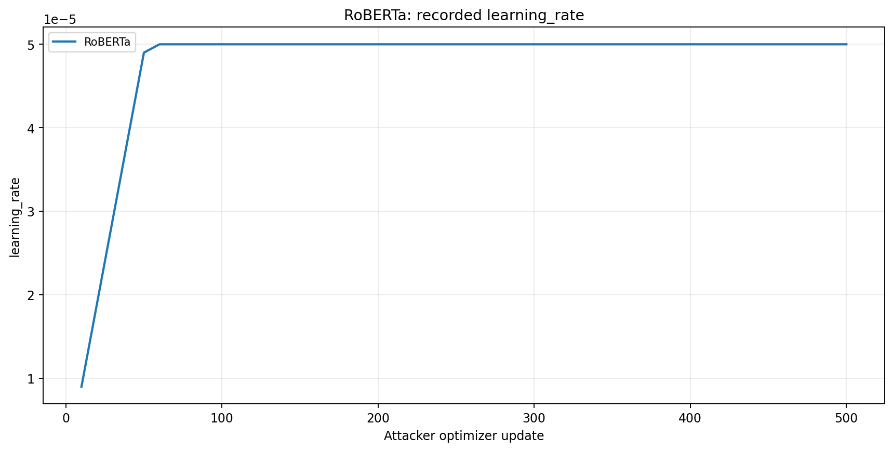

[Source CSV](figures/research/retained-roberta-learning_rate.csv) · [Vector SVG](figures/research/retained-roberta-learning_rate.svg).

| updates | generated_texts | evasion |
| --- | --- | --- |
| 0 | 100 | 0.0000 |
| 50 | 100 | 0.0000 |
| 100 | 100 | 0.0000 |
| 150 | 100 | 0.0600 |
| 200 | 100 | 0.1900 |
| 250 | 100 | 0.1900 |
| 300 | 100 | 0.0900 |
| 350 | 100 | 0.5900 |
| 400 | 100 | 0.8800 |
| 450 | 100 | 0.8700 |
| 500 | 100 | 0.9800 |
| 550 | 100 | 0.9300 |
| 600 | 100 | 0.3600 |

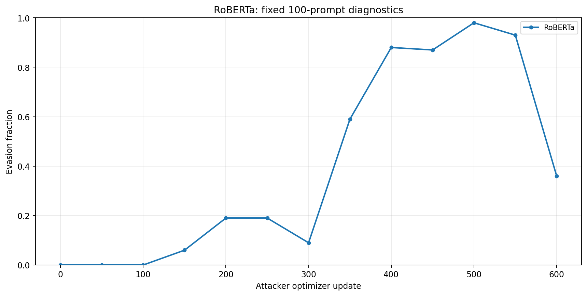

[Source CSV](figures/research/retained-roberta-diagnostic-evasion.csv) · [Vector SVG](figures/research/retained-roberta-diagnostic-evasion.svg).

The RoBERTa trajectory uses a separate individual-attacker protocol: 50-update warm-up to `5e-5`, then a constant rate through 600. Evasion was 98% at 500, 93% at 550 and 36% at 600 on the same 100 prompts. The full 500-text evaluation at 600 gave 39.2% evasion. Only the step-500 model is retained; later measurements remain as evidence of fluctuation. A high score at one checkpoint therefore does not establish stable convergence.

## Interpretation limits

Training budgets and target detectors differ across the long runs, so their final scores are not a matched-budget architecture ranking. These are single-seed results. The diagnostic evaluation set has informed protocol choices and is not an untouched final test. The retained evaluations show evasion against frozen warmed defenders; the new jobs measure whether defender updates recover detection.

## Current experiment: one defender update per retained attacker

Three independent jobs generate training outputs on the existing 1,000 fitting prompts, pair them with human passages, and update the warmed defender(s). Torch defenders use the existing three-epoch supervised update and paired 80/20 training/validation split. The 500 evaluation prompts are excluded from training. The post-defense measurement reuses exactly the saved attack texts from the original evaluation. No attacker optimizer runs and no second round starts in these submissions.

## Architecture races: 20261022T135029612516Z

1 planned rounds. One defender update per branch; zero new attacker updates. Each branch starts from its retained attacker and the original warmed defender(s). Allocation: 02:00:00; QoS: qos_gpu_h100-dev. Checkpoint pauses requeue the same job.

[Shared metrics after every evaluation](../results/research_workflow/defender_comparison/races_100/20261022T135029612516Z/metrics.csv). Rows identify the race, round, phase, detector and cumulative attacker updates. Concurrent writes are locked; replayed measurements do not add duplicate rows.

### gemma: job 1447844

Status: completed; completed rounds: 1/1.

Retained attacker: `/lustre/fswork/projects/rech/mbm/ual37ci/bench_research_ml_project/split-repos/ai-content-robustness/results/research_workflow/defender_comparison/rl/decoder/checkpoint-1213`, trained for **1213 updates**. Initial evaluations reuse the saved texts and scores after identity checks. Post-defense evaluation reuses exactly those attack texts.

| round | detector | before | after_attack | after_defense |
| --- | --- | --- | --- | --- |
| 1 | decoder_classifier | 0.0000 | 0.7720 | 0.0020 |
| 1 | ensemble_mean | 0.0000 | 0.7720 | 0.0020 |

The after-attack and after-defense measurements reuse identical generated texts.
[Source CSV](figures/research/race100-20261022T135029612516Z-gemma-decoder_classifier.csv) · [Vector SVG](figures/research/race100-20261022T135029612516Z-gemma-decoder_classifier.svg)

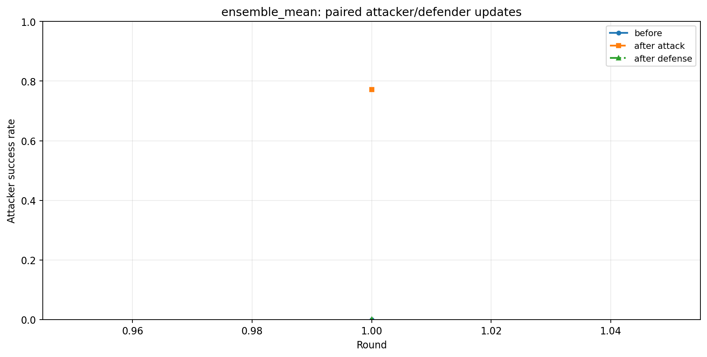

The after-attack and after-defense measurements reuse identical generated texts.
[Source CSV](figures/research/race100-20261022T135029612516Z-gemma-ensemble_mean.csv) · [Vector SVG](figures/research/race100-20261022T135029612516Z-gemma-ensemble_mean.svg)

Round-one checkpoint reuse: Retained attacker; begin with its first defender update.

These are single-seed results. Successful warm-up and robustness must be assessed from the measurements; neither is guaranteed by the training procedure.

| round | phase | detector | attack_success_rate | ai_detection_rate | human_false_positive_rate | roc_auc | semantic_similarity | num_generated | num_ineligible_pairs |
| --- | --- | --- | --- | --- | --- | --- | --- | --- | --- |
| 1 | before | decoder_classifier | 0.0000 | 1.0000 | 0.0000 | 1.0000 | undefined | 500 | 0 |
| 1 | after_attack | decoder_classifier | 0.7720 | 0.2280 | 0.0000 | 0.9124 | 0.8867 | 500 | 0 |
| 1 | after_defense | decoder_classifier | 0.0020 | 0.9980 | 0.0020 | 1.0000 | 0.8867 | 500 | 0 |

### modernbert: job 1447845

Status: completed; completed rounds: 1/1.

Retained attacker: `/lustre/fswork/projects/rech/mbm/ual37ci/bench_research_ml_project/split-repos/ai-content-robustness/results/research_workflow/defender_comparison/rl/encoder/checkpoint-1487`, trained for **1487 updates**. Initial evaluations reuse the saved texts and scores after identity checks. Post-defense evaluation reuses exactly those attack texts.

| round | detector | before | after_attack | after_defense |
| --- | --- | --- | --- | --- |
| 1 | modernbert_large | 0.0100 | 0.9680 | 0.0100 |
| 1 | ensemble_mean | 0.0100 | 0.9680 | 0.0100 |

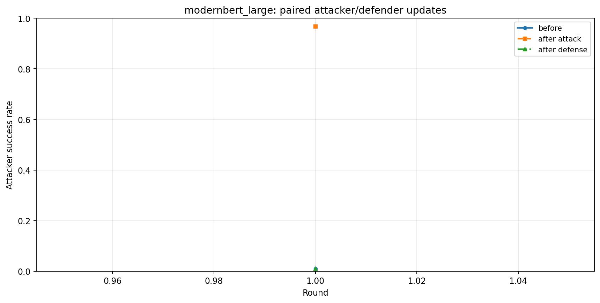

The after-attack and after-defense measurements reuse identical generated texts.
[Source CSV](figures/research/race100-20261022T135029612516Z-modernbert-modernbert_large.csv) · [Vector SVG](figures/research/race100-20261022T135029612516Z-modernbert-modernbert_large.svg)

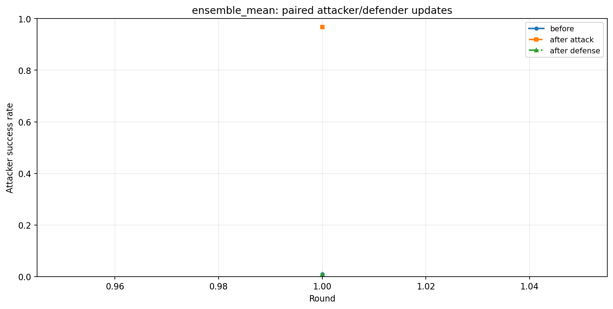

The after-attack and after-defense measurements reuse identical generated texts.
[Source CSV](figures/research/race100-20261022T135029612516Z-modernbert-ensemble_mean.csv) · [Vector SVG](figures/research/race100-20261022T135029612516Z-modernbert-ensemble_mean.svg)

Round-one checkpoint reuse: Retained attacker; begin with its first defender update.

These are single-seed results. Successful warm-up and robustness must be assessed from the measurements; neither is guaranteed by the training procedure.

| round | phase | detector | attack_success_rate | ai_detection_rate | human_false_positive_rate | roc_auc | semantic_similarity | num_generated | num_ineligible_pairs |
| --- | --- | --- | --- | --- | --- | --- | --- | --- | --- |
| 1 | before | modernbert_large | 0.0100 | 0.9900 | 0.0160 | 0.9992 | undefined | 500 | 0 |
| 1 | after_attack | modernbert_large | 0.9680 | 0.0320 | 0.0160 | 0.7104 | 0.8821 | 500 | 0 |
| 1 | after_defense | modernbert_large | 0.0100 | 0.9900 | 0.0040 | 0.9998 | 0.8821 | 500 | 0 |

### ensemble: job 1447846

Status: completed; completed rounds: 1/1.

Retained attacker: `/lustre/fswork/projects/rech/mbm/ual37ci/bench_research_ml_project/split-repos/ai-content-robustness/results/research_workflow/defender_comparison/rl/ensemble/checkpoint-502`, trained for **502 updates**. Initial evaluations reuse the saved texts and scores after identity checks. Post-defense evaluation reuses exactly those attack texts.

| round | detector | before | after_attack | after_defense |
| --- | --- | --- | --- | --- |
| 1 | binoculars | 0.0140 | 0.9400 | 0.0060 |
| 1 | fast_detect_gpt | 0.0000 | 0.9300 | 0.0000 |
| 1 | diveye | 0.0280 | 0.8100 | 0.0700 |
| 1 | roberta | 0.0000 | 0.9220 | 0.0080 |
| 1 | tfidf | 0.1140 | 0.9660 | 0.0580 |
| 1 | modernbert_large | 0.0100 | 0.9800 | 0.0080 |
| 1 | decoder_classifier | 0.0000 | 0.7700 | 0.0020 |
| 1 | ensemble_mean | 0.0000 | 0.9480 | 0.0040 |

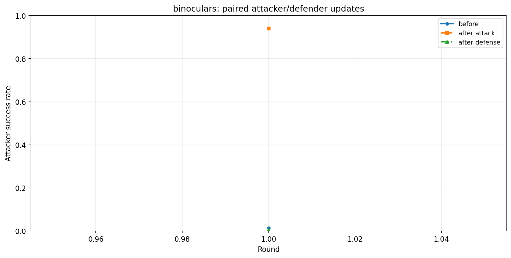

The after-attack and after-defense measurements reuse identical generated texts.
[Source CSV](figures/research/race100-20261022T135029612516Z-ensemble-binoculars.csv) · [Vector SVG](figures/research/race100-20261022T135029612516Z-ensemble-binoculars.svg)

The after-attack and after-defense measurements reuse identical generated texts.
[Source CSV](figures/research/race100-20261022T135029612516Z-ensemble-fast_detect_gpt.csv) · [Vector SVG](figures/research/race100-20261022T135029612516Z-ensemble-fast_detect_gpt.svg)

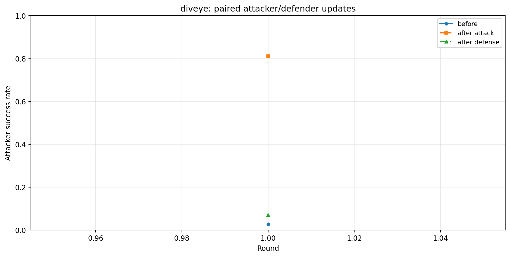

The after-attack and after-defense measurements reuse identical generated texts.
[Source CSV](figures/research/race100-20261022T135029612516Z-ensemble-diveye.csv) · [Vector SVG](figures/research/race100-20261022T135029612516Z-ensemble-diveye.svg)

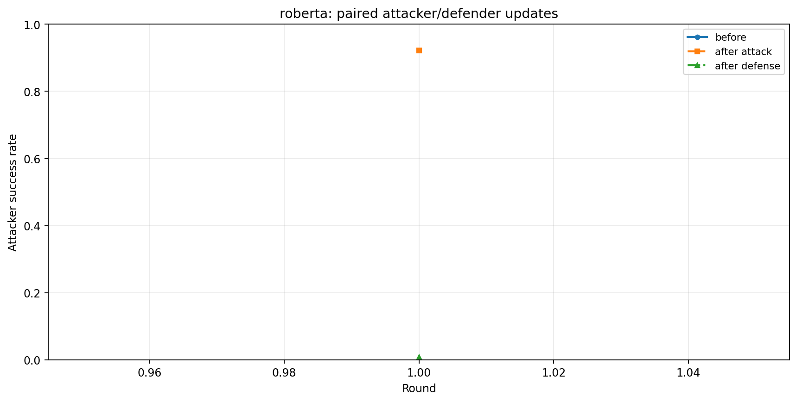

The after-attack and after-defense measurements reuse identical generated texts.
[Source CSV](figures/research/race100-20261022T135029612516Z-ensemble-roberta.csv) · [Vector SVG](figures/research/race100-20261022T135029612516Z-ensemble-roberta.svg)

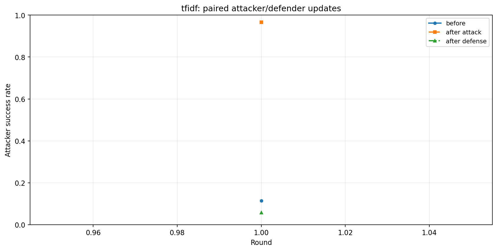

The after-attack and after-defense measurements reuse identical generated texts.
[Source CSV](figures/research/race100-20261022T135029612516Z-ensemble-tfidf.csv) · [Vector SVG](figures/research/race100-20261022T135029612516Z-ensemble-tfidf.svg)

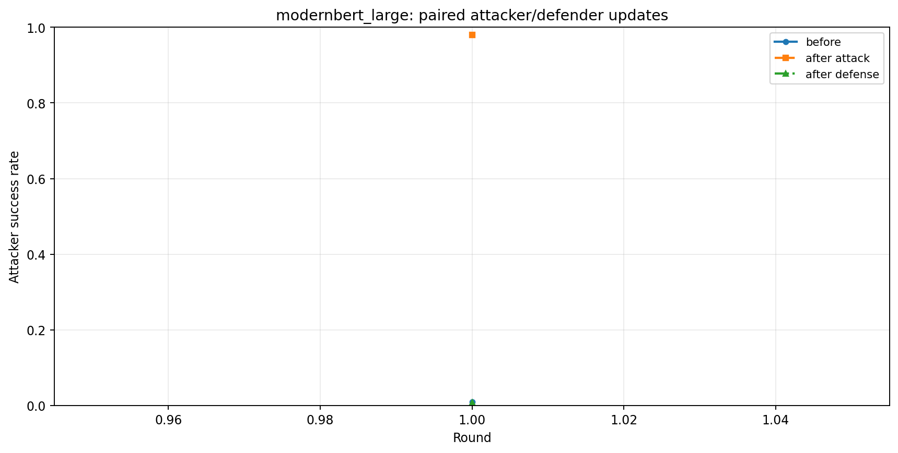

The after-attack and after-defense measurements reuse identical generated texts.
[Source CSV](figures/research/race100-20261022T135029612516Z-ensemble-modernbert_large.csv) · [Vector SVG](figures/research/race100-20261022T135029612516Z-ensemble-modernbert_large.svg)

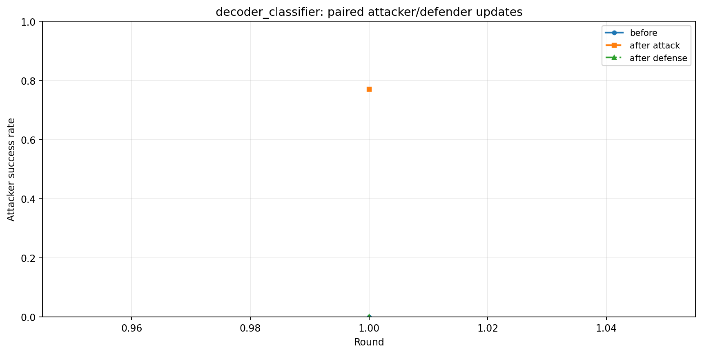

The after-attack and after-defense measurements reuse identical generated texts.
[Source CSV](figures/research/race100-20261022T135029612516Z-ensemble-decoder_classifier.csv) · [Vector SVG](figures/research/race100-20261022T135029612516Z-ensemble-decoder_classifier.svg)

The after-attack and after-defense measurements reuse identical generated texts.
[Source CSV](figures/research/race100-20261022T135029612516Z-ensemble-ensemble_mean.csv) · [Vector SVG](figures/research/race100-20261022T135029612516Z-ensemble-ensemble_mean.svg)

Round-one checkpoint reuse: Retained attacker; begin with its first defender update.

These are single-seed results. Successful warm-up and robustness must be assessed from the measurements; neither is guaranteed by the training procedure.

| round | phase | detector | attack_success_rate | ai_detection_rate | human_false_positive_rate | roc_auc | semantic_similarity | num_generated | num_ineligible_pairs |
| --- | --- | --- | --- | --- | --- | --- | --- | --- | --- |
| 1 | before | binoculars | 0.0140 | 0.9860 | 0.0080 | 0.9998 | undefined | 500 | 0 |
| 1 | before | fast_detect_gpt | 0.0000 | 1.0000 | 0.0000 | 1.0000 | undefined | 500 | 0 |
| 1 | before | diveye | 0.0280 | 0.9720 | 0.0280 | 0.9970 | undefined | 500 | 0 |
| 1 | before | roberta | 0.0000 | 1.0000 | 0.0340 | 0.9983 | undefined | 500 | 0 |
| 1 | before | tfidf | 0.1140 | 0.8860 | 0.0180 | 0.9834 | undefined | 500 | 0 |
| 1 | before | modernbert_large | 0.0100 | 0.9900 | 0.0160 | 0.9992 | undefined | 500 | 0 |
| 1 | before | decoder_classifier | 0.0000 | 1.0000 | 0.0000 | 1.0000 | undefined | 500 | 0 |
| 1 | after_attack | binoculars | 0.9400 | 0.0600 | 0.0080 | 0.6103 | 0.8701 | 500 | 0 |
| 1 | after_attack | fast_detect_gpt | 0.9300 | 0.0700 | 0.0000 | 0.4984 | 0.8701 | 500 | 0 |
| 1 | after_attack | diveye | 0.8100 | 0.1900 | 0.0280 | 0.7795 | 0.8701 | 500 | 0 |
| 1 | after_attack | roberta | 0.9220 | 0.0780 | 0.0340 | 0.5555 | 0.8701 | 500 | 0 |
| 1 | after_attack | tfidf | 0.9660 | 0.0340 | 0.0180 | 0.3939 | 0.8701 | 500 | 0 |
| 1 | after_attack | modernbert_large | 0.9800 | 0.0200 | 0.0160 | 0.6956 | 0.8701 | 500 | 0 |
| 1 | after_attack | decoder_classifier | 0.7700 | 0.2300 | 0.0000 | 0.9150 | 0.8701 | 500 | 0 |
| 1 | after_defense | binoculars | 0.0060 | 0.9940 | 0.0160 | 0.9997 | 0.8701 | 500 | 0 |
| 1 | after_defense | fast_detect_gpt | 0.0000 | 1.0000 | 0.0000 | 1.0000 | 0.8701 | 500 | 0 |
| 1 | after_defense | diveye | 0.0700 | 0.9300 | 0.0580 | 0.9829 | 0.8701 | 500 | 0 |
| 1 | after_defense | roberta | 0.0080 | 0.9920 | 0.0020 | 0.9999 | 0.8701 | 500 | 0 |
| 1 | after_defense | tfidf | 0.0580 | 0.9420 | 0.0700 | 0.9432 | 0.8701 | 500 | 0 |
| 1 | after_defense | modernbert_large | 0.0080 | 0.9920 | 0.0160 | 0.9991 | 0.8701 | 500 | 0 |
| 1 | after_defense | decoder_classifier | 0.0020 | 0.9980 | 0.0000 | 1.0000 | 0.8701 | 500 | 0 |

## Updated defenders on the base model

This check reuses the original 500 reserved base-Qwen outputs and 500 human passages. It generates no new text and performs no training. The comparison uses threshold 0.5 before and after the defender update; the earlier model is the Qwen-warmed defender, before adaptation to the RL attacker.

gemma: base-Qwen detection changes from 100.0% to 100.0%; human false positives change from 0.0% to 0.2%. modernbert: base-Qwen detection changes from 99.0% to 90.2%; human false positives change from 1.6% to 0.4%. ensemble: base-Qwen detection changes from 100.0% to 98.4%; human false positives change from 0.2% to 0.0%.

| branch | detector | AI_texts | AI_detection_before | AI_detection_after | human_FPR_before | human_FPR_after | AUROC_after |
| --- | --- | --- | --- | --- | --- | --- | --- |
| gemma | decoder_classifier | 500 | 1.0000 | 1.0000 | 0.0000 | 0.0020 | 1.0000 |
| modernbert | modernbert_large | 500 | 0.9900 | 0.9020 | 0.0160 | 0.0040 | 0.9972 |
| ensemble | binoculars | 500 | 0.9860 | 0.9720 | 0.0080 | 0.0160 | 0.9990 |
| ensemble | fast_detect_gpt | 500 | 1.0000 | 0.9900 | 0.0000 | 0.0000 | 0.9999 |
| ensemble | diveye | 500 | 0.9720 | 0.9380 | 0.0280 | 0.0580 | 0.9855 |
| ensemble | roberta | 500 | 1.0000 | 0.9800 | 0.0340 | 0.0020 | 0.9972 |
| ensemble | tfidf | 500 | 0.8860 | 0.2820 | 0.0180 | 0.0700 | 0.6158 |
| ensemble | modernbert_large | 500 | 0.9900 | 0.9640 | 0.0160 | 0.0160 | 0.9981 |
| ensemble | decoder_classifier | 500 | 1.0000 | 1.0000 | 0.0000 | 0.0000 | 1.0000 |
| ensemble | ensemble_mean | 500 | 1.0000 | 0.9840 | 0.0020 | 0.0000 | 1.0000 |

The largest observed base-detection decrease is ensemble/tfidf: 88.6% to 28.2%, with post-update human false positives of 7.0% and AUROC 0.6158. Aggregate ensemble performance can conceal such member-level losses.

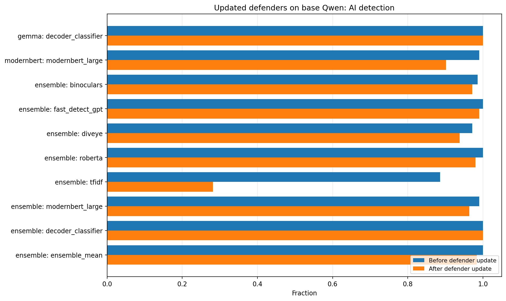

[Source CSV](figures/research/base-retest-20261022T135029612516Z-AI_detection.csv) · [Vector SVG](figures/research/base-retest-20261022T135029612516Z-AI_detection.svg).

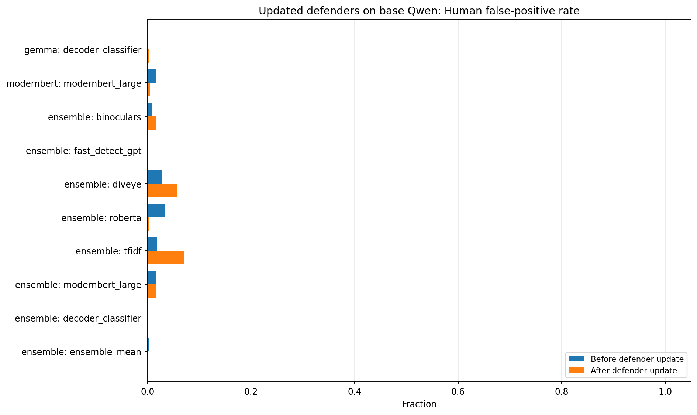

[Source CSV](figures/research/base-retest-20261022T135029612516Z-human_FPR.csv) · [Vector SVG](figures/research/base-retest-20261022T135029612516Z-human_FPR.svg).

This measures retention on base outputs after learning the fixed RL attack. A drop in base detection shows that recovering detection on the RL outputs does not automatically preserve the original operating point. The human false-positive rate and AUROC help distinguish that tradeoff from a broad loss of ranking quality. This does not measure robustness to a new adaptive attacker.

[Shared base-evaluation metrics](../results/research_workflow/defender_comparison/races_100/20261022T135029612516Z/base_retest/metrics.csv).

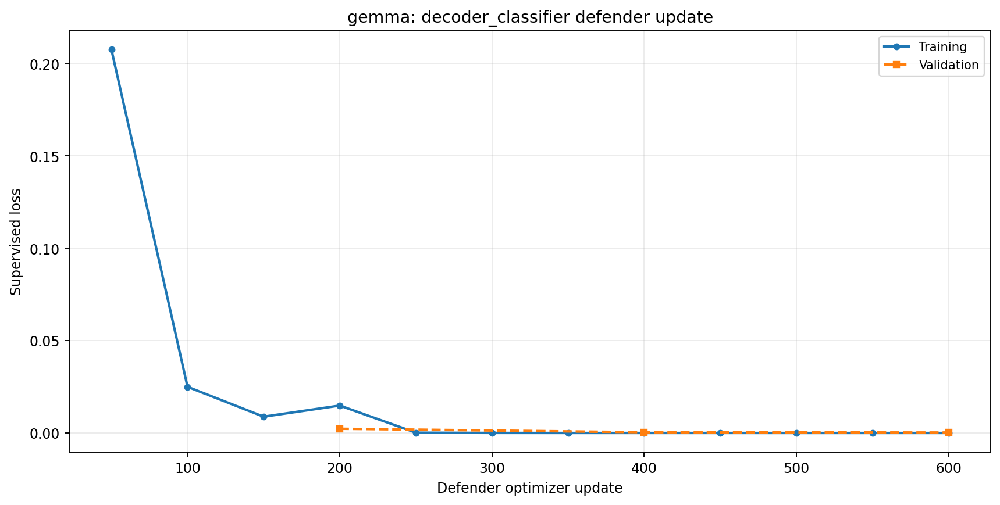

[Source CSV](figures/research/defense-20261022T135029612516Z-gemma-decoder_classifier-loss.csv) · [Vector SVG](figures/research/defense-20261022T135029612516Z-gemma-decoder_classifier-loss.svg).

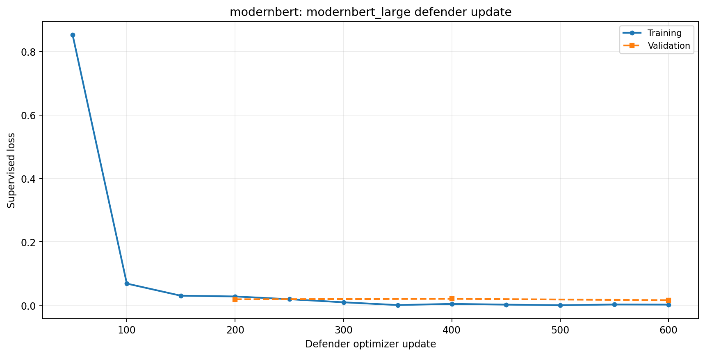

[Source CSV](figures/research/defense-20261022T135029612516Z-modernbert-modernbert_large-loss.csv) · [Vector SVG](figures/research/defense-20261022T135029612516Z-modernbert-modernbert_large-loss.svg).

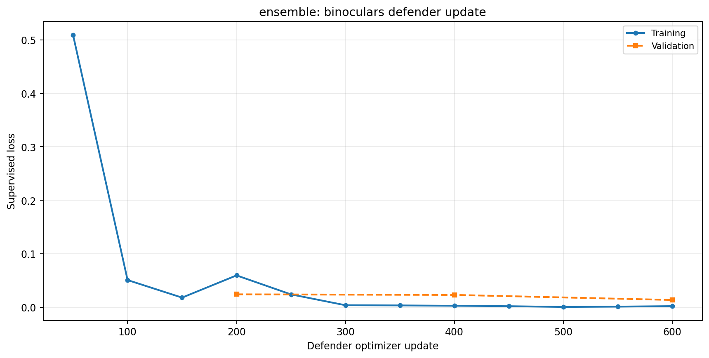

[Source CSV](figures/research/defense-20261022T135029612516Z-ensemble-binoculars-loss.csv) · [Vector SVG](figures/research/defense-20261022T135029612516Z-ensemble-binoculars-loss.svg).

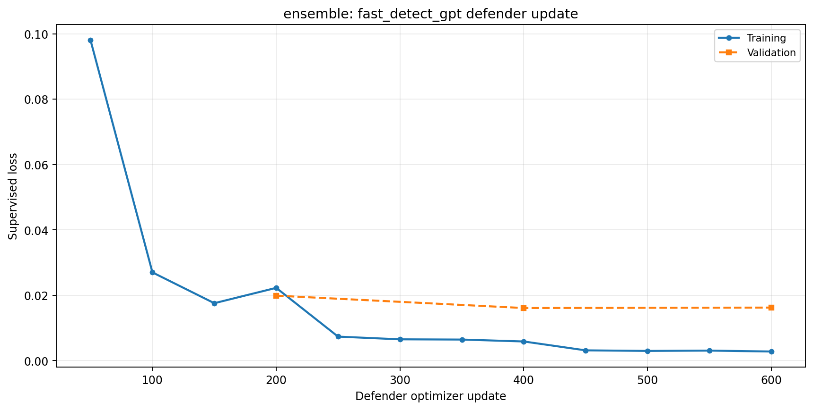

[Source CSV](figures/research/defense-20261022T135029612516Z-ensemble-fast_detect_gpt-loss.csv) · [Vector SVG](figures/research/defense-20261022T135029612516Z-ensemble-fast_detect_gpt-loss.svg).

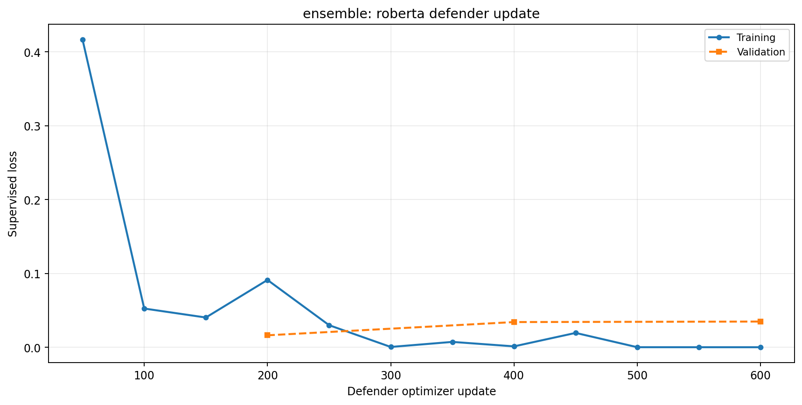

[Source CSV](figures/research/defense-20261022T135029612516Z-ensemble-roberta-loss.csv) · [Vector SVG](figures/research/defense-20261022T135029612516Z-ensemble-roberta-loss.svg).

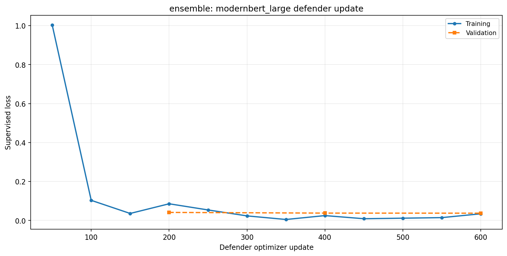

[Source CSV](figures/research/defense-20261022T135029612516Z-ensemble-modernbert_large-loss.csv) · [Vector SVG](figures/research/defense-20261022T135029612516Z-ensemble-modernbert_large-loss.svg).

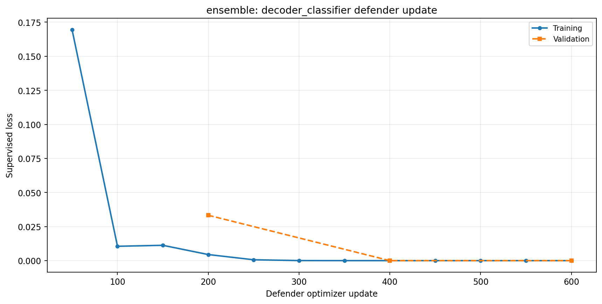

[Source CSV](figures/research/defense-20261022T135029612516Z-ensemble-decoder_classifier-loss.csv) · [Vector SVG](figures/research/defense-20261022T135029612516Z-ensemble-decoder_classifier-loss.svg).
