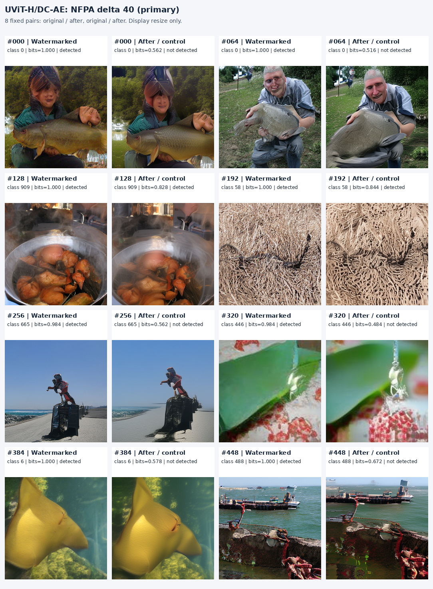
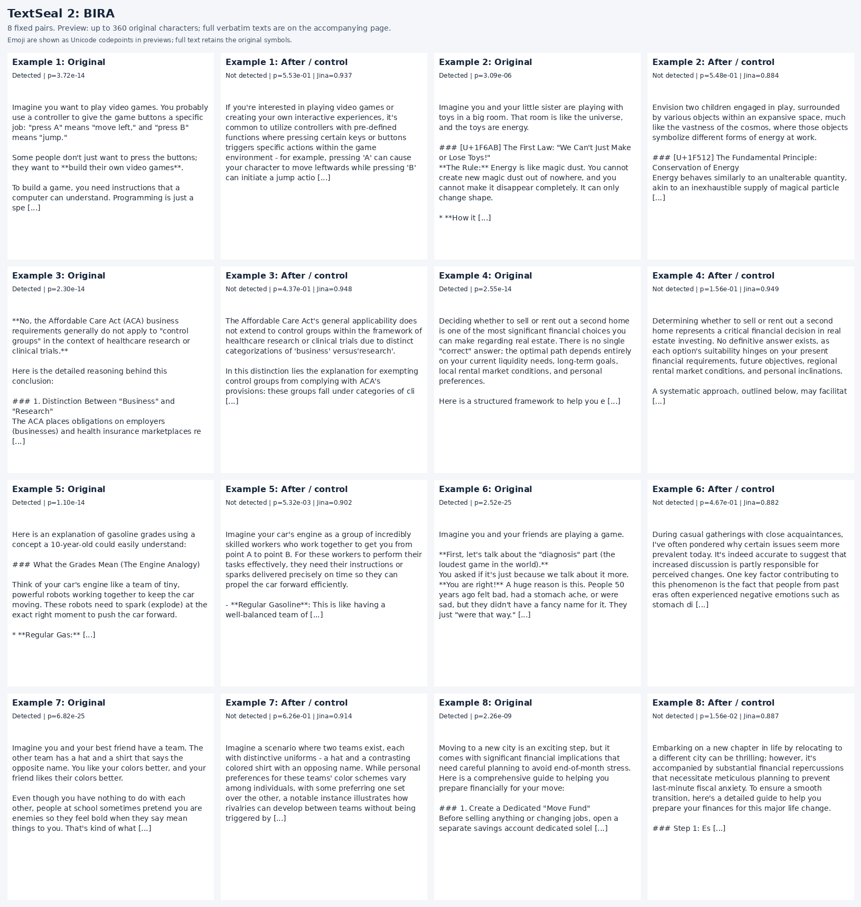

# Watermarking and removal: retained results

This directory retains portable metrics and qualitative assets for the [full LaTeX report](../../tex/report.pdf). Research sections below now link to separate TeX records. Operational Markdown and original assets remain available without model weights or ignored experiment directories.

## Start here

| Page | Coverage |
| --- | --- |
| [Text metrics](../../tex/records/docs/watermarking/text.tex) | TextSeal 2 and DistSeal-inspired Qwen instruct teacher/student; all four removal methods and controls |
| [Image metrics](../../tex/records/docs/watermarking/images.tex) | RAR and DC-AE; all weight merges, clean LoRA/full updates, NFPA strengths and controls |
| [JPEG/crop robustness](../../tex/records/docs/watermarking/robustness.tex) | Every retained recorded image output-transform/weight-condition combination |
| [Historical appendix](../../tex/records/docs/watermarking/historical.tex) | Earlier single-class image pilots and incomplete independent OPT/Llama paper controls |
| [Metric definitions](../../tex/records/docs/watermarking/metrics.tex) | Thresholds, uncertainty, access assumptions and interpretation |
| [Portable metrics](data/metrics.json) | Machine-readable full summaries, including both text operating points and image subgroups |
| [Selected examples](data/examples.json) | Full sampled texts, image input hashes, owner scores and fixed sample IDs |
| [Audit manifest](publication.json) | Hashes of the published files and source result identifiers |

Primary targets are Qwen/Qwen3.5-4B instruct, released DistSeal RAR-XL and UViT-H/DC-AE. BIRA uses Llama-3.1-8B-Instruct. DistSeal-inspired text is an experimental adaptation, not an official paper text implementation. TextSeal 1 and deleted Qwen-Base runs are excluded.

## Text snapshot

| Watermark | Condition | Detected | n |
| --- | --- | --- | --- |
| TextSeal 2 | Original marked output | 98.8% | 256 |
| TextSeal 2 | Ordinary paraphrasing | 5.9% | 256 |
| TextSeal 2 | BIRA | 0.0% | 256 |
| TextSeal 2 | Direct top-10 resampling | 0.4% | 256 |
| TextSeal 2 | Confidence smoothing (adapted) | 0.0% | 256 |
| DistSeal-inspired student | Original marked output | 46.1% | 256 |
| DistSeal-inspired student | Ordinary paraphrasing | 3.5% | 256 |
| DistSeal-inspired student | BIRA | 0.4% | 256 |
| DistSeal-inspired student | Direct top-10 resampling | 39.8% | 256 |
| DistSeal-inspired student | Confidence smoothing (adapted) | 7.0% | 256 |

TextSeal 2's primary criterion is nominal p<=0.001. The student uses a different frozen validation-derived extractor threshold; it is not a Gamma p-value. Raw evasion must be read alongside the NLI, similarity and quality tables.

## Image snapshot

| Model | Condition | Detected | LPIPS | Class CLIP |
| --- | --- | --- | --- | --- |
| RAR-XL | Unmodified watermarked model | 100.0% | 0.0000 | 0.3030 |
| RAR-XL | Clean LoRA: 2,500 steps | 4.9% | 0.6692 | 0.3044 |
| RAR-XL | Clean full training: 2,500 steps | 7.2% | 0.6618 | 0.3032 |
| RAR-XL | NFPA delta 40 (primary) | 21.5% | 0.4221 | 0.2630 |
| UViT-H/DC-AE | Unmodified watermarked model | 100.0% | 0.0000 | 0.2934 |
| UViT-H/DC-AE | Clean LoRA: 2,500 steps | 0.2% | 0.1510 | 0.2840 |
| UViT-H/DC-AE | Clean full training: 2,500 steps | 0.4% | 0.2148 | 0.2816 |
| UViT-H/DC-AE | NFPA delta 40 (primary) | 33.6% | 0.5082 | 0.2664 |

All primary image settings and quality metrics are in the full [image tables](../../tex/records/docs/watermarking/images.tex). Weight access and output-only access differ. Paired distances after a weight change can reflect a different valid image rather than poor generation quality.

## Qualitative examples: eight pairs each

Every method page provides a 16-panel comparison and the fixed sample IDs. Captions retain unsuccessful attacks and originally undetected text outputs. No examples were selected using detection or aesthetic quality.

### Example image grid: DC-AE / NFPA delta 40



[Full comparison and per-pair scores](../../tex/records/docs/watermarking/qualitative/image-dcae-output-nfpa-40.tex). The figure can contain visible detail and framing changes; it does not assert exact semantic preservation.

### Example text grid: TextSeal 2 / BIRA



[Full verbatim responses, prompts and diagnostics](../../tex/records/docs/watermarking/qualitative/text-textseal2-bira.tex). The image is a preview, not the complete response.

## Sources and reproduction

The source experiments and revisions are identified in the [source index](data/sources.json). These identifiers describe local provenance; readers do not need those private filesystem locations to view this report. Raw model weights and full datasets remain outside Git.

With retained local experiment artifacts available, rebuild from the repository root:

```bash
PYTHONPATH=. uv run --no-sync python scripts/publish_watermark_results.py --check
PYTHONPATH=. uv run --no-sync python scripts/publish_watermark_results.py --check
```

The check command uses only published files, validates artifact hashes and local document links, and verifies eight pairs per figure. Historical partial quality is explicitly labeled with its observed coverage; planned schemes without retained outputs are not presented as completed tests.

### Method references

- [TextSeal 2](https://arxiv.org/abs/2610.40613).
- [DistSeal, ICML 2026](https://proceedings.mlr.press/v306/rebuffi26a.html); text here is an experimental adaptation.
- [BIRA](https://arxiv.org/abs/2509.23019), using the released Llama implementation.
- Confidence smoothing: *Watermark Smoothing Attacks against Language Models*, Findings EMNLP 2025; the unknown-watermark mixing variant here is an adaptation.
- [NFPA, NeurIPS 2025](https://proceedings.neurips.cc/paper_files/paper/2025/hash/b48405307576689bea14d221ccba73ae-Abstract-Conference.html).

Method protocols: [text](../../tex/records/docs/instruct_watermarking.tex), [image weight access](../../tex/records/docs/watermarking.tex), [NFPA output-only](../../tex/records/docs/closed_image_watermarking.tex), [matched quality](../../tex/records/docs/matched_image_quality.tex), [Jina](../../tex/records/docs/jina_similarity.tex).

Manuscript tables are regenerated with `tex/generate.py` and the development analysis commands in the repository README. The historical Markdown exporter requires `--legacy-markdown --output LEGACY_EXPORT_DIRECTORY` and cannot overwrite this directory.
